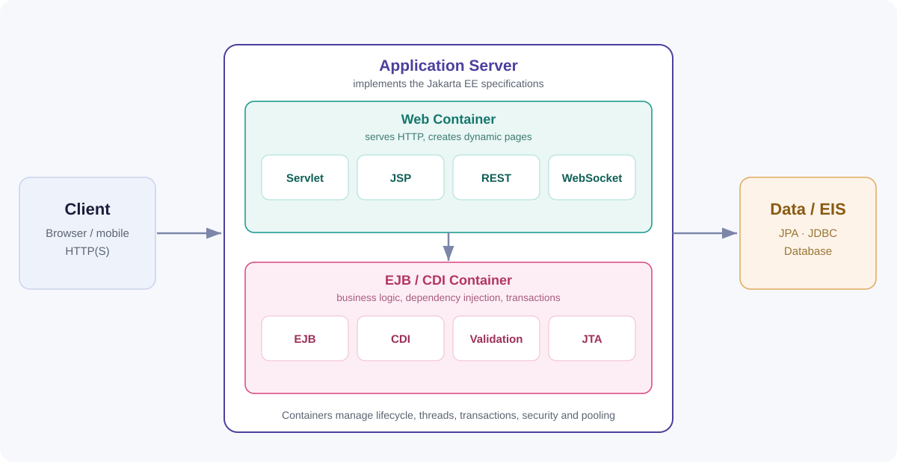
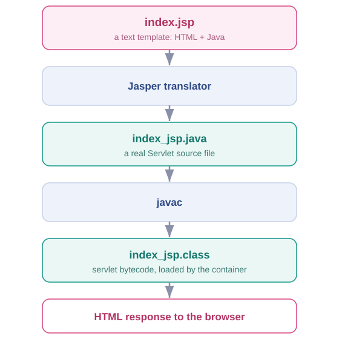
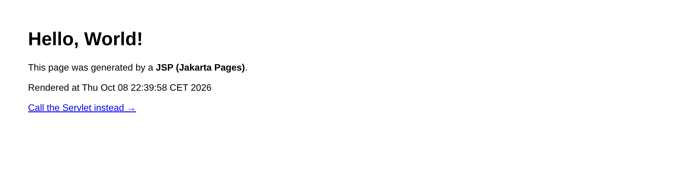
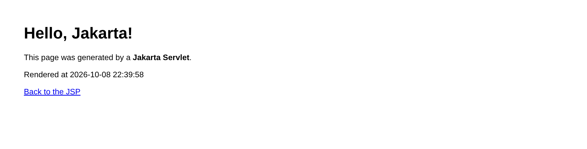

<style>
:root {
  --navy: #1b1f3b;
  --indigo: #4b3f9e;
  --blue: #2f6fb3;
  --accent: #d94f86;
  --teal: #1f9c8f;
  --ink: #1c2330;
  --muted: #5b6472;
  --line: #dfe4ec;
  --code-bg: #0f172a;
}

section {
  font-family: "Segoe UI", "Helvetica Neue", Arial, sans-serif;
  color: var(--ink);
  background: #ffffff;
  font-size: 24px;
  line-height: 1.34;
  padding: 46px 58px 56px;
  letter-spacing: 0.1px;
}

h1 {
  color: var(--indigo);
  font-size: 38px;
  font-weight: 700;
  margin: 0 0 16px;
  letter-spacing: -0.2px;
}
h2 { color: var(--blue); font-size: 27px; margin: 0 0 10px; }
h3 { color: var(--navy); font-size: 23px; margin: 14px 0 6px; }
p, li { margin: 6px 0; }
li { margin-left: 2px; }
strong { color: var(--navy); }
a { color: var(--blue); }
ul, ol { margin: 8px 0 8px 2px; padding-left: 26px; }

code {
  font-family: "JetBrains Mono", "Fira Code", "Consolas", monospace;
  font-size: 0.9em;
}
pre {
  background: var(--code-bg);
  border-radius: 10px;
  padding: 12px 16px;
  font-size: 16px;
  line-height: 1.35;
  box-shadow: inset 0 0 0 1px #1e293b;
}
pre code { background: transparent; color: #e8eef7; }
:not(pre) > code {
  background: #eef2f8;
  color: #1d3a63;
  border-radius: 5px;
  padding: 1px 6px;
}

table {
  font-size: 19px;
  border-collapse: collapse;
  width: 100%;
  margin: 6px 0;
}
th {
  background: var(--navy);
  color: #fff;
  text-align: left;
  padding: 6px 11px;
  font-weight: 600;
}
td { padding: 5px 11px; border-bottom: 1px solid var(--line); vertical-align: top; }
tr:nth-child(even) td { background: #f6f8fc; }

section::after { color: #9aa4b2; font-size: 15px; right: 30px; bottom: 18px; }

/* Title slide */
section.title {
  background: linear-gradient(135deg, #1b1f3b 0%, #3b2f7a 58%, #b23563 125%);
  color: #ffffff;
  display: flex;
  flex-direction: column;
  justify-content: center;
  padding: 0 76px;
}
section.title h1 { color: #ffffff; font-size: 62px; margin: 0 0 2px; }
section.title .title-sub { color: #d7d3f4; font-size: 28px; font-weight: 500; margin: 0 0 22px; }
section.title .title-tags {
  display: inline-block;
  background: rgba(255,255,255,0.12);
  border: 1px solid rgba(255,255,255,0.28);
  border-radius: 24px;
  padding: 8px 22px;
  font-size: 19px;
  color: #ffffff;
  letter-spacing: 0.3px;
  align-self: flex-start;
}
section.title .title-meta { color: #c9c4e6; font-size: 19px; margin-top: 26px; }
section.title::after { color: rgba(255,255,255,0.55); }

/* Layout helpers */
.cols { display: flex; gap: 30px; align-items: flex-start; }
.cols > div { flex: 1; min-width: 0; }
.col-58 { flex: 0 0 58% !important; }
.col-46 { flex: 0 0 46% !important; }
.col-52 { flex: 0 0 52% !important; }
.col-48 { flex: 0 0 48% !important; }
.col-44 { flex: 0 0 44% !important; }
.col-56 { flex: 0 0 56% !important; }
.col-50 { flex: 0 0 50% !important; }
.col-42 { flex: 0 0 42% !important; }
.caption { color: var(--muted); font-size: 16px; margin-top: 8px; }
.muted { color: var(--muted); font-weight: 400; }

.note {
  background: #fff7ef;
  border-left: 5px solid #e8762c;
  padding: 9px 14px;
  border-radius: 6px;
  font-size: 19px;
  margin-top: 12px;
}

/* Flow diagram */
.flow {
  display: flex;
  align-items: center;
  justify-content: center;
  gap: 12px;
  font-size: 18px;
  margin: 12px 0 18px;
  flex-wrap: wrap;
}
.flow .box {
  background: #f2f6fc;
  border: 1px solid #cdd9ea;
  border-radius: 8px;
  padding: 10px 16px;
  text-align: center;
}
.flow .arrow { color: #e8762c; font-weight: 700; }
.flow.v { flex-direction: column; gap: 4px; margin: 10px 0 14px; }
.flow.v .box { width: 100%; padding: 9px 12px; }

/* Screenshots */
.shots img {
  width: 100%;
  border: 1px solid var(--line);
  border-radius: 7px;
  box-shadow: 0 6px 16px rgba(20,35,70,0.14);
  display: block;
}
.shots figure { margin: 0 0 12px; }
.shots figcaption { color: var(--muted); font-size: 15px; margin-top: 5px; }

img { image-rendering: -webkit-optimize-contrast; }
</style>

<!-- _class: title -->
<!-- _paginate: false -->

# Jakarta EE

<p class="title-sub">The standard platform for enterprise Java</p>

<p class="title-tags">Servlets &nbsp;·&nbsp; Jakarta Pages (JSP) &nbsp;·&nbsp; CDI &nbsp;·&nbsp; EJB &nbsp;·&nbsp; JPA &nbsp;·&nbsp; REST</p>

<p class="title-meta">
Computer Science &mdash; Jakarta EE &nbsp;|&nbsp; Lecture 01<br>
Formerly known as <b>Java EE</b>
</p>

---

# What is Jakarta EE?

<div class="cols">
<div class="col-58">

**Jakarta EE** (formerly **Java EE**) is a collection of **open specifications** for building **enterprise applications** in Java.

- It is a **standard**, not a product or a single framework.
- **Vendors implement** the specifications in **application servers**.
- Built on top of **Java SE** (the language + standard library).
- Your components run inside **containers** managed by the server.

<div class="note">
&ldquo;Enterprise&rdquo; = web applications, business logic, persistence, messaging and security &mdash; built to scale.
</div>

</div>
<div class="col-42">

| Year | Milestone |
| --- | --- |
| 1999 | J2EE 1.2 &mdash; first release (Sun) |
| 2006 | Renamed **Java EE 5** |
| 2017 | Oracle donates it to Eclipse |
| 2018 | Renamed **Jakarta EE** |
| 2025 | Current: **Jakarta EE 11** |

<p class="caption">Since EE 9 the packages use <code>jakarta.*</code> instead of <code>javax.*</code>.</p>

</div>
</div>

---

# How Jakarta EE Works

<div class="cols">
<div class="col-46">

- **Specifications** define the contracts (Servlet, JSP, JPA, CDI&hellip;).
- A **vendor** implements them: WildFly, Payara, GlassFish, Open Liberty, TomEE.
- You package your application (e.g. a **WAR** or **EAR**) and deploy it.
- The server provides **containers** that host your components and give them services for free.

<div class="note">
You focus on <b>business logic</b>; the container handles threading, transactions, connection pooling and security.
</div>

</div>
<div class="col-54">



</div>
</div>

---

# How a Request Is Handled

<div class="flow">
  <div class="box"><b>Browser</b><br>GET /hello</div>
  <div class="arrow">&rarr;</div>
  <div class="box"><b>Web container</b><br>maps the URL</div>
  <div class="arrow">&rarr;</div>
  <div class="box"><b>Servlet</b><br>service() &rarr; doGet()</div>
  <div class="arrow">&rarr;</div>
  <div class="box"><b>Response</b><br>HTML to the browser</div>
</div>

- The container receives the **HTTP request** and matches the **URL pattern** to a servlet.
- It calls `service()`, which dispatches to **`doGet`** or **`doPost`** based on the HTTP method.
- The servlet writes to a **`response`** object; the container sends it back to the client.
- **One servlet instance** serves **many requests on many threads** &mdash; servlets must be thread-safe.

<p class="caption">The same container also serves static files, JSPs and REST endpoints.</p>

---

# Servlets

<div class="cols">
<div class="col-52">

A **Servlet** is a Java class that runs **inside a web container**, receives HTTP requests and produces HTTP responses.

```java
@WebServlet("/hello")
public class HelloServlet extends HttpServlet {

    @Override
    protected void doGet(HttpServletRequest req,
                         HttpServletResponse resp)
            throws IOException {
        resp.setContentType("text/html");
        resp.getWriter().println("Hello, World!");
    }
}
```

</div>
<div class="col-48">

**Lifecycle &mdash; managed by the container**

<div class="flow v">
  <div class="box"><b>init()</b> <span class="muted">&mdash; once</span></div>
  <div class="arrow">&darr;</div>
  <div class="box"><b>service()</b> <span class="muted">&mdash; every request</span></div>
  <div class="arrow">&darr;</div>
  <div class="box"><b>destroy()</b> <span class="muted">&mdash; on shutdown</span></div>
</div>

- Mapped by **annotation** or `web.xml`.
- Read input with `request.getParameter(...)`.
- Write output with `response.getWriter()`.

</div>
</div>

---

# Jakarta Pages (JSP)

<div class="cols">
<div class="col-56">

A **JSP** is a **text template** that mixes HTML with Java. It is **compiled into a servlet** the first time it is used.

```jsp
<h1>Hello, <%= name %>!</h1>
<p>Rendered at <%= new java.util.Date() %></p>
```

- `<% ... %>` = scriptlet (Java code) &nbsp;·&nbsp; `<%= ... %>` = print an expression.
- **Expression Language** (`${...}`) and **JSTL** keep templates free of Java.
- **MVC:** the servlet is the controller, the JSP is the view.

<p class="caption">Same runtime as a servlet &mdash; a JSP <b>is</b> a servlet, generated for you.</p>

</div>
<div class="col-44">



</div>
</div>

---

# Putting It Together &mdash; a Jakarta EE 11 Hello World

<div class="cols">
<div class="col-52">

**A Maven WAR project** &mdash; Java 17+, `jakarta.jakartaee-api:11.0.0`

```
hello-world/
├── pom.xml
└── src/main/
    ├── java/com/example/helloworld/
    │   └── HelloServlet.java   (@WebServlet)
    └── webapp/
        ├── index.jsp
        └── WEB-INF/web.xml
```

1. `mvn package` &rarr; `target/hello-world.war`
2. Deploy it to a Jakarta EE 11 server
3. Visit `/index.jsp` and `/hello?name=Jakarta`

</div>
<div class="col-48">

<div class="shots">
<figure><figcaption><b>index.jsp</b> &mdash; rendered by the JSP engine</figcaption></figure>
<figure><figcaption><b>/hello</b> &mdash; rendered by the servlet</figcaption></figure>
</div>

<p class="caption">Both screenshots are the real app running on Apache Tomcat 11 (Servlet 6.1).</p>

</div>
</div>

---

# The Web Container: Apache Tomcat

<div class="cols">
<div class="col-56">

**Apache Tomcat** is the reference implementation of the **Jakarta Servlet** and **Jakarta Pages (JSP)** specifications &mdash; a free, open-source **web container**.

| Tomcat | Servlet / JSP | Jakarta EE |
| --- | --- | --- |
| 10.1 | 6.0 / 3.1 | EE 10 |
| **11.0** | **6.1 / 4.0** | **EE 11** |

- Built from **Catalina** (servlet container) + **Jasper** (JSP engine).
- You deploy by dropping a **WAR** into its `webapps/` folder.

</div>
<div class="col-44">

<div class="note">
Tomcat is a <b>web container</b>, not a full application server: it gives you Servlets, JSP and WebSocket &mdash; but <b>no</b> EJB, CDI or JPA. Use WildFly / Payara / GlassFish for the full platform.
</div>

<p class="caption">Download: <code>tomcat.apache.org</code> &mdash; Tomcat 11 is perfect for our Hello World app.</p>

</div>
</div>

---

# Installing Tomcat 11 on Windows

<div class="cols">
<div class="col-50">

**1 &mdash; Install a JDK 17+**
Eclipse Temurin or Oracle JDK. Note the install path.

**2 &mdash; Download Tomcat 11**
From `tomcat.apache.org`, take the **64-bit Windows zip** and extract it to `C:\tomcat11` (avoid spaces in the path).

<p class="caption">Shortcut: the <b>Windows Service Installer (.exe)</b> on the same page configures <code>JAVA_HOME</code> and runs Tomcat as a Windows service for you.</p>

**3 &mdash; Set `JAVA_HOME`** (System &rarr; Environment Variables):

```bat
setx JAVA_HOME "C:\Program Files\Eclipse Adoptium\jdk-21-hotspot"
```

</div>
<div class="col-50">

**4 &mdash; Start Tomcat**

```bat
cd C:\tomcat11\bin
startup.bat
```

**5 &mdash; Verify** &mdash; open <http://localhost:8080>; the Tomcat welcome page should appear.

**6 &mdash; Deploy the app** &mdash; copy `hello-world.war` into `C:\tomcat11\webapps\`, then open <http://localhost:8080/hello-world/>.

```bat
shutdown.bat
```

</div>
</div>

---

# Summary &amp; References

<div class="cols">
<div class="col-54">

**Jakarta EE in one line**
- A set of **specifications** for enterprise Java.
- Implemented by **application servers**; your code runs in **containers**.
- Current version: **Jakarta EE 11** (Java 17+, `jakarta.*`).

**Servlets &amp; JSP**
- **Servlet** = Java class that handles HTTP requests.
- **JSP** = HTML template compiled into a servlet.
- Together they build the **web layer**; CDI / EJB / JPA add the rest.

<h3>Run the Hello World project</h3>

```bash
cd hello-world
mvn package   # builds target/hello-world.war
```

</div>
<div class="col-46">

<h3>References &amp; further reading</h3>

- Jakarta EE &mdash; <https://jakarta.ee/>
- EE 11 Platform &mdash; <https://jakarta.ee/specifications/platform/11/>
- Servlet 6.1 &mdash; <https://jakarta.ee/specifications/servlet/6.1/>
- Pages (JSP) 4.0 &mdash; <https://jakarta.ee/specifications/pages/4.0/>
- Apache Tomcat 11 &mdash; <https://tomcat.apache.org/>

<p class="caption">Next lecture: the servlet lifecycle and request handling in depth.</p>

</div>
</div>
